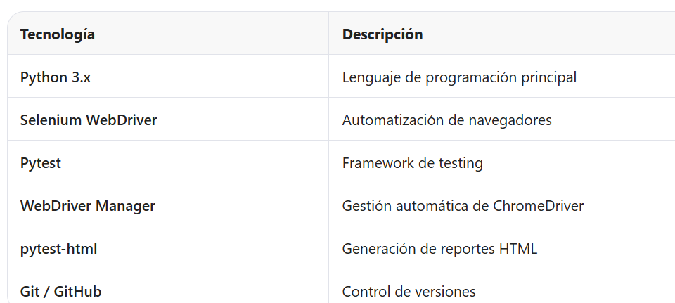

# Pre-Entrega: Automatización QA - SauceDemo

##  Propósito del proyecto
Automatizar flujos básicos de navegación web en el sitio SauceDemo (https://www.saucedemo.com/) aplicando los conocimientos adquiridos en el curso de Automatización QA. Se implementan tres casos de prueba:

1. Login automatizado con espera explícita y validación de redirección.
2. Verificación del catálogo de productos (título, presencia y listado).
3. Interacción con el carrito (agregar producto y validar contador).

##  Tecnologías utilizadas

## Cómo instalar las dependencias
1. Clonar el repositorio:
`bash`
git clone https://github.com/[tu-usuario]/pre-entrega-automation-testing-[tu-nombre].git
cd pre-entrega-automation-testing-[tu-nombre]

2. Crear y activar un entorno virtual (recomendado):
`bash`
python -m venv venv
source venv/bin/activate   # Linux/macOS
venv\Scripts\activate      # Windows

3. Instalar las dependencias:
`bash`
pip install -r requirements.txt

4. El archivo requirements.txt debe contener:
selenium
pytest
pytest-html
webdriver-manager

## Cómo ejecutar las pruebas
Ejecución básica (modo verbose):
`bash`
pytest tests/ -v

Ejecución con generación de reporte HTML:
`bash`
pytest tests/ -v --html=reports/reporte.html --self-contained-html

Ejecutar un test específico:
`bash`
pytest tests/test_saucedemo.py::test_login_exitoso -v

El reporte se generará en la carpeta reports/reporte.html y podrá abrirse directamente en el navegador.